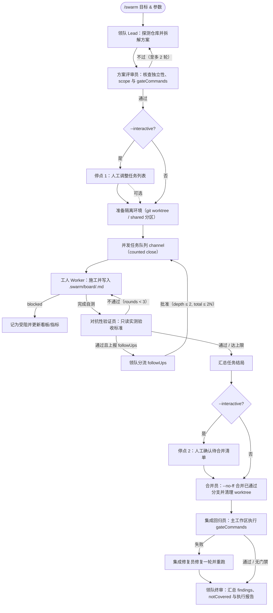

<div align="center">


# zcode-swarm

**一条目标，拉起一支有分工、有对抗验收、有动态回流的多智能体小队。**

移植自 Google Antigravity 的 `/swarm` 协作范式，基于 [ZCode](https://github.com/zai-org/ZCode) 原生 `dynamic-workflows` 运行时从零构建。

[简体中文](#为什么做-zcode-swarm) · [English](#english) · [示例报告](examples/) · [Changelog](CHANGELOG.md)

</div>

---

## 为什么做 `zcode-swarm`

很多“多 Agent 协作”本质上是给主模型塞一段长 Prompt，让它临场决定要不要找人帮忙——拆解全靠发挥、范围容易踩踏、干没干完也只是自己说自己对。

`zcode-swarm` 把整套协作写成了一份**类型化的 TypeScript 编排脚本**（[`swarm.dwf.ts`](skills/swarm/workflow/swarm.dwf.ts)）：

1. **先评审再开工**：领队拆出任务后，必须先过「方案评审员」这一关，确认每个子任务自包含、范围不重叠、验收标准可实测，才放工人进场。
2. **一任务一对抗验证员**：每个工人写完代码，立刻交给独立只读的「对抗性验证员」按验收标准逐条跑命令、打开文件核对；不通过直接打回原工作区修复（至多 3 轮），**未过验证的分支绝不合进主干**。
3. **运行中可动态长出新任务**：工人在施工中发现缺失公共文件、上游前置依赖或相邻缺口时，通过 `followUps` 上报；领队分流审核后直接回流同一条并发队列，继续走隔离、验证、合并与回归。
4. **全程可观测、可中途接管**：运行期实时产出任务看板、阶段进度指标、工人消息板、实施计划与最终执行报告；加上 `--interactive` 还能在拆解确认后、收尾合并前两次停下来等你拍板。

---

## 工作流总览



---

## 核心机制

| 机制 | 实现方式 | 设计意图 |
|---|---|---|
| **隔离与安全清理** | Git 仓库默认 `git worktree`（每任务 `.swarm/<id>` + `swarm/<id>` 分支）；非 Git 仓库或 `--isolation shared` 自动降级共享工作区 + `scope` 分区 | 代码互不踩踏；建树前按 `worktree remove -> rmSync -> prune -> branch -D` 顺序清残留，失败则响亮回退共享并记入报告 |
| **动态生命周期** | `channel<WorkItem>` + 计数关闭（`reserveSlot` 同步占位 + `dispatch` 入队），嵌套深度上限 `MAX_DEPTH = 2`，总任务数封顶 `2× 初始任务数` | 既支持施工中发现真实缺口后追加子任务，又防止并发分流突破上限或队列提前关闭 |
| **无锁文件信箱** | 每名工人只写 `.swarm/board/<id>.md`，条目以 `## ` 开头；支持 `[@对方id]` 定向捎话与 `[@all]` 广播 | 避开并发写同一文件的锁竞争；脚本在 `ask` 边界统一收割投递，并实时推流至「消息板」卡片；每次运行开工前自动清空重建 |
| **对抗验证与回归门禁** | 每任务独立只读验证员（封顶 3 轮）+ 合并后由「集成回归员」在主工作区重跑仓库 `gateCommands` | 把“单任务跑通”与“多分支合并后整体能跑”拆开把关，过滤 `.swarm/` 与预期产物后仅报告非预期脏改动 |

---

## 安装与使用

### 安装

- **方式 A · 插件市场一键安装（推荐）**
  仓库根目录内置 [`marketplace.json`](marketplace.json)，可直接把本仓库作为 ZCode 插件市场添加：
  1. 在 ZCode 中打开 `Plugin Marketplace` -> `Add` -> `Add Plugin Marketplace`
  2. 输入仓库地址 `rimesekai/Zcode-swarm`
  3. 在市场列表中找到 `ZCode Swarm（蜂群模式）` 点击 `Install` 即可
- **方式 B · 手动安装**
  将技能目录与编排脚本放到 ZCode 用户目录：
  ```bash
  mkdir -p ~/.zcode/skills ~/.zcode/workflows
  cp -r skills/swarm ~/.zcode/skills/swarm
  cp skills/swarm/workflow/swarm.dwf.ts ~/.zcode/workflows/swarm.dwf.ts
  ```
  - 说明：[`SKILL.md`](skills/swarm/SKILL.md) 在每次执行前都会通过 `ListSavedWorkflows` 自检全局 `swarm` 工作流及参数签名；若缺失或版本过旧，会自动从技能目录 `workflow/swarm.dwf.ts` 补装或备份后更新。

> 如果你此前曾手动安装过旧版 `~/.zcode/skills/swarm`，建议在启用插件版前先移除该个人目录，避免同名技能相互遮蔽。

### 调用语法

```text
/swarm <目标> [--agents N] [--isolation auto|worktree|shared] [--interactive] [--model <providerId/modelId>]
```

| 参数 | 默认值 | 说明 |
|---|---|---|
| `<目标>` | 必填 | 一句话说清要做什么、边界与验收标准是什么 |
| `--agents` | `4` | 并行工人数（范围 `1`–`10`；任务天然只需 1–2 块时建议调小，节省 Token） |
| `--isolation` | `auto` | `auto`（Git 仓库自动启用 `worktree`，非 Git 自动回退 `shared`）/ `worktree` / `shared` |
| `--interactive` | `false` | 开启后在「拆解方案确认后」与「收尾合并前」分别暂停，支持中途微调任务或跳过某分支合并 |
| `--model` | 继承当前 | 整支小队统一切换到指定模型（完整 `providerId/modelId`） |

**使用示例**

```text
/swarm 给项目补齐 src/pack.js 与独立测试 tests/pack.test.js，要求 node tests/pack.test.js 输出 PASS --agents 2
/swarm 调研仓库认证模块与缓存层性能瓶颈，分别输出到 docs/audit-auth.md 和 docs/audit-cache.md --isolation shared
/swarm 重构订单状态机并补全集成测试 --agents 3 --interactive
```

---

## `.swarm/` 目录说明

- `.swarm/board/`：工人通信信箱。**每次开跑前自动清空**，跑完后保留在工作区供复盘消息流水。
- `.swarm/<id>/`：worktree 模式下各子任务的临时工作树。验证通过且合并成功后自动移除；未通过验证或受阻任务的现场会原地保留，方便人工排查。
- 建议把 `.swarm/` 加入目标仓库的 `.gitignore`；工作流收尾的 `git status` 洁净检查会自动忽略 `.swarm/`。

---

## 实测边界与透明度

截至 `v0.1.0`，主干流程已通过 **4 轮真实端到端测试**（涵盖 `worktree` 隔离合并、`shared` + 纯调研、`followUps` 动态回流 + `--interactive` 双停点、最终落盘版全链路闭环）与 **5 份片段级逻辑回归**：

- **已实测通过**
  - `worktree` 创建、残留清理（含先拆树删目录再 `prune` 后删分支的顺序修复）、`--no-ff` 合并与自动收尾清理
  - 脏工作区开工警告与收尾 `git status` 路径过滤（含 Git 对未跟踪目录折叠输出的兼容）
  - `shared` 共享工作区 + `scope` 范围分区 + 纯 `research` 零 Git 写操作
  - `followUps` 工人上报 → 领队分流 → 嵌套 worktree 创建 → 多分支联合合并
  - `--interactive` 两个 `hole` 停点的真实暂停、修改与续跑
  - 信箱 `[@id]` / `[@all]` 路由、跨轮次重置与「消息板 / 看板 / 进度指标 / 报告」四件套产出
  - 合并后 `gateCommands` 集成回归通过路径
- **尚未在真实运行中自然触发的兜底分支（代码已实现并经审查，留待真实使用检验）**
  - 验证员打回后的**工人修复轮**（4 轮测试均在第 1 轮即通过验证）
  - 工人主动上报 `blocked` 或 `escalate` 的中断收尾路径
  - 合并员处理 `git merge` 冲突的分支
  - `gateCommands` 失败后拉起「集成修复员」的修复再跑闭环
  - 多工人高并发同时上报 `followUps` 撞上 `maxTotal` 上限截断（已通过 `reserveSlot` 同步占位消除竞态，尚未高并发压测）

如在真实使用中遇到上述分支表现异常，欢迎附执行报告提 Issue。

---

## 示例与相关项目

### 真实运行报告示例（[`examples/`](examples/)）

- [`report-run1-worktree-basic.md`](examples/report-run1-worktree-basic.md)：基础 `worktree` 模式完整报告与逐条命令核对记录
- [`report-run3-followups-interactive.md`](examples/report-run3-followups-interactive.md)：`followUps` 动态回流 + `--interactive` 停点 + 三分支合并报告

### Related Work

- [marcopesani/swarm-skill](https://github.com/marcopesani/swarm-skill)：同样采用“领队 + worktree 工人 + 审计”思路，但通过外部 `pi` 进程与 SQLite 消息板适配多客户端；`zcode-swarm` 专注在 ZCode 原生 `dynamic-workflows` 运行时内实现零外部依赖的类型化编排、独立对抗验证与实时 UI 卡片。
- [wjgoarxiv/antigravity-swarm](https://github.com/wjgoarxiv/antigravity-swarm)（已更名 LitGravity）：侧重为 CLI 增加“计划 → 测试 → 评审 → 交接”工作纪律提示，并非并行的多 Agent 蜂群编排；本项目命名为 `zcode-swarm` 以作区分。

---

## English

**zcode-swarm** brings Google Antigravity's `/swarm` multi-agent experience to [ZCode](https://github.com/zai-org/ZCode) — implemented from scratch as a typed, deterministic [`dynamic-workflows`](skills/swarm/workflow/swarm.dwf.ts) orchestration pipeline rather than a single free-form prompt.

### How It Works

1. **Plan & Independent Critique**: A Lead explores the repo and breaks the goal into self-contained tasks (`code` or `research`), scoped to avoid conflicts. An independent Critic reviews the plan before any worker starts.
2. **Isolated Parallel Execution**: Git repositories default to one `git worktree` (`.swarm/<id>`, branch `swarm/<id>`) per code task; non-git directories or `--isolation shared` fall back to shared workspace partitioning.
3. **Adversarial Per-Task Verification**: Every completed task goes to a dedicated read-only Verifier that runs real commands and inspects files against acceptance criteria (up to 3 fix rounds). Unverified branches are never merged.
4. **Dynamic Lifecycle (`followUps`)**: Workers can report missing prerequisites or newly discovered follow-up tasks; the Lead triages and feeds approved tasks back into the same concurrent queue (`MAX_DEPTH = 2`, capped at `2×` initial tasks).
5. **Lock-Free File Mailbox & Live Artifacts**: Workers communicate across isolated sessions via append-only `.swarm/board/<id>.md` files (`[@task-id]` / `[@all]`), harvested at `ask` boundaries and streamed live to a 7-column Kanban board, progress metrics, message table, and final report.
6. **Merge, Regression Gate & Final Audit**: Verified branches are `--no-ff` merged, cleaned up, checked against repository `gateCommands` in the main workspace, and audited by the Lead.

### Install & Usage

**Option A · Plugin Marketplace (Recommended)**: add `rimesekai/Zcode-swarm` in ZCode via `Plugin Marketplace` -> `Add` -> `Add Plugin Marketplace`, then install `ZCode Swarm`.

**Option B · Manual Install**:

```bash
mkdir -p ~/.zcode/skills ~/.zcode/workflows
cp -r skills/swarm ~/.zcode/skills/swarm
cp skills/swarm/workflow/swarm.dwf.ts ~/.zcode/workflows/swarm.dwf.ts
```

On every run, [`SKILL.md`](skills/swarm/SKILL.md) verifies `ListSavedWorkflows` and installs/repairs the global workflow script automatically.

```text
/swarm <goal> [--agents N] [--isolation auto|worktree|shared] [--interactive] [--model <providerId/modelId>]
```

### Tested Scope & Limitations

- **Verified across 4 real end-to-end runs + 5 unit snippets**: `worktree` isolation/merge/cleanup (including cleanup ordering & stale branch recovery), `shared` + `research` mode, `followUps` requeue + nested worktrees, `--interactive` pauses (`hole`), mailbox `@`-routing & run reset, regression gate pass path, and live dashboard artifacts.
- **Implemented & reviewed, 0 natural triggers in the 4 runs**: verifier rejection repair loops (`rounds > 1`), `blocked`/`escalate` terminations, `git merge` conflict resolution, post-regression repair loop, and concurrent `followUps` hitting `maxTotal`. If any of these paths behave unexpectedly in real usage, please open an issue with the execution report.

---

## 致谢 · Acknowledgements

设计灵感源自 Google Antigravity 的 `/swarm` 命令；编排脚本、结构化 Schema、提示词与插件包装均针对 ZCode 从零独立实现，未复用原作代码或文本。

## License

[MIT](LICENSE)
